<p align="center">
  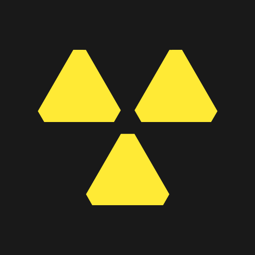
</p>

<h1 align="center">RadiaCode Wear OS</h1>

<p align="center">
  A standalone Wear OS app for <strong>RadiaCode</strong> gamma spectrometers.<br>
  Connects to the detector directly over Bluetooth LE - no phone app, no cloud, no account.
</p>

<p align="center">
  
  
  
  
  
</p>

<p align="center">
  <a href="#demo"><strong>Demo</strong></a> ·
  <a href="#quick-start"><strong>Quick start</strong></a> ·
  <a href="#exporting-tracks"><strong>Exporting tracks</strong></a> ·
  <a href="#architecture"><strong>Architecture</strong></a>
</p>

---

## Demo

All screenshots below were captured directly from a Galaxy Watch connected to a RadiaCode-110.

### App

<p align="center">
  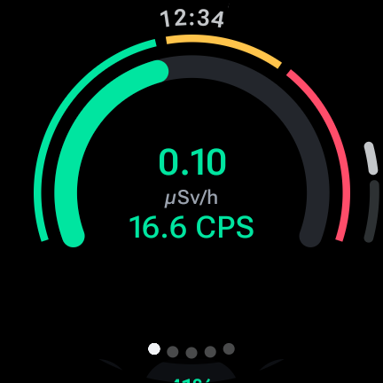
  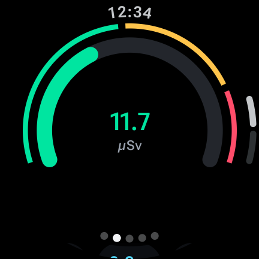
  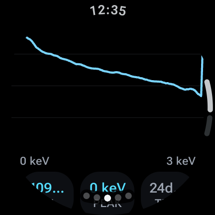
  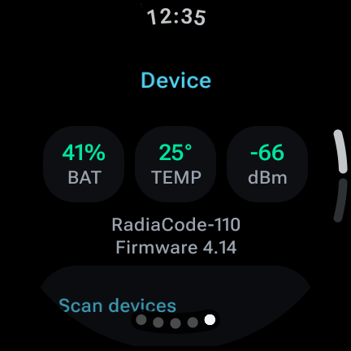
</p>

<p align="center">
  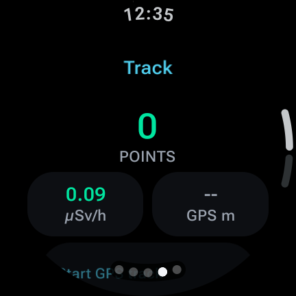
  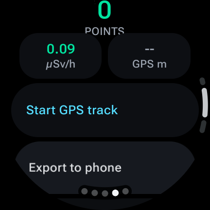
  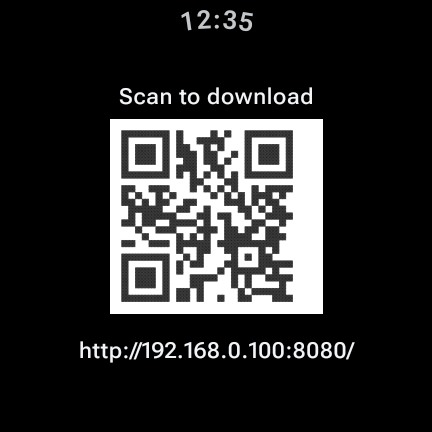
</p>

### Tiles

<p align="center">
  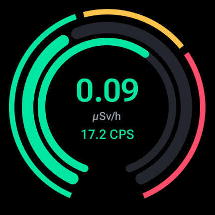
  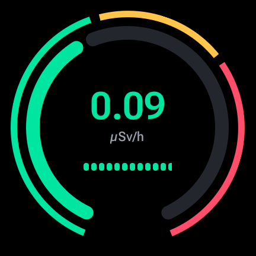
  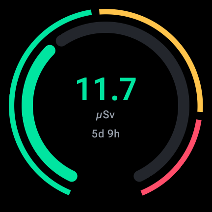
</p>

<p align="center">
  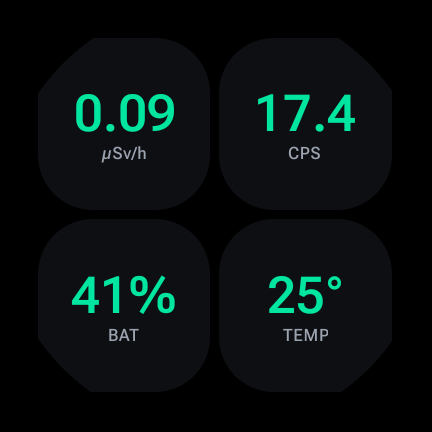
  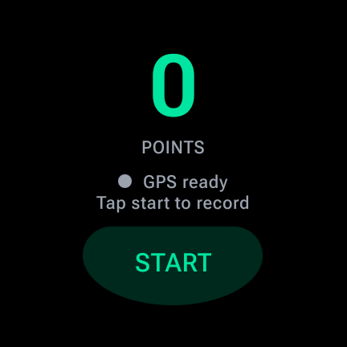
</p>

| Feature | What it does |
|---------|--------------|
| **Live monitor** | Dose rate and count rate on a three-zone gauge (normal, warning, alarm) |
| **Accumulated dose** | Total dose since the last reset on the detector |
| **Spectrum** | Live gamma spectrum with energy axis, peak and acquisition time |
| **Device** | Detector battery, temperature, BLE signal, model and firmware; scan and switch devices |
| **GPS tracks** | Records dose rate along a GPS path into `.rctrk` files on the watch |
| **Track export** | Built-in HTTP server with a QR code - scan it with any phone on the same Wi-Fi to download tracks |
| **Tiles** | Rates, Dose rate, Count rate, Accumulated dose, Status and Track (with GPS fix status and START/STOP) |
| **Complications** | Dose rate, count rate, accumulated dose, tracking, battery, temperature, signal, dose history and rate graphs |
| **Watch face** | Watch Face Format face with digital or analog layout and a configurable accent color |
| **Alarms** | Two-level dose rate, count rate and accumulated dose alarms using the detector thresholds, with vibration on the wrist |
| **Settings** | Alarms, units, display, signal events and device actions, written straight to the detector |

---

## Quick start

### Requirements

- Watch running Wear OS 3 or newer (API 30+), with Bluetooth LE and GPS
- RadiaCode RC-10x / RC-110 detector
- JDK 17 or newer, Android SDK with platform 37 and `platform-tools` (`adb`)
- Gradle wrapper is included - no global Gradle install needed

### Connect the watch

Enable **Developer options → Wireless debugging** on the watch, then:

```bash
WATCH_IP=192.168.0.100 WATCH_PORT=39493 ./scripts/watch-connect.sh
```

For a first-time pairing pass the pairing port and code as well:

```bash
WATCH_IP=192.168.0.100 WATCH_PAIR_PORT=37099 WATCH_PAIR_CODE=123456 WATCH_PORT=39493 ./scripts/watch-connect.sh
```

### Build and deploy

```bash
./scripts/watch-deploy.sh
```

This builds the `wear` app and the `watchface`, installs both on the watch only, and launches the app. To build without installing:

```bash
./gradlew :wear:assembleDebug :watchface:assembleDebug
```

Follow the app logs with:

```bash
./scripts/watch-logs.sh
```

### Tests

```bash
./gradlew :protocol:test :track:test
```

---

## Exporting tracks

Tracks never need a companion app to leave the watch.

1. Open the **Track** page and tap **Export to phone** (or **Export tracks** on the Device page).
2. The watch joins Wi-Fi and starts a small HTTP server on port `8080`.
3. Scan the QR code with any phone or laptop camera on the same network.
4. Download individual `.rctrk` files or everything at once as `tracks.zip`.

The server only runs while the export screen is open and stops as soon as you leave it.

<p align="center">
  
</p>

---

## GPS status on the Track tile

The Track tile shows the GPS state before and during recording, so you know whether points are actually being logged.

| State | Meaning |
|-------|---------|
| **GPS off** | Location is disabled on the watch |
| **GPS ready** | Location is available, recording has not started |
| **Searching** | Recording, but no fix yet or the last fix is older than 10 s |
| **Weak ±N m** | Fix accuracy is worse than 20 m |
| **GPS locked** | Good fix, points are being recorded |

---

## Architecture

| Module | Responsibility |
|--------|----------------|
| `protocol` | RadiaCode wire protocol: framing, commands, SFR/VSFR registers, data buffers, spectrum decoding |
| `transport-ble` | Bluetooth LE transport, notification draining, logging |
| `device` | Device session: initialization, status merging, configuration and device actions |
| `track` | `.rctrk` track reader, writer and recorder |
| `wear` | Wear OS app: Compose UI, foreground monitoring service, tiles, complications, alarms, GPS, track export server |
| `watchface` | Watch Face Format watch face that consumes the app complications |

```
┌───────────────┐   BLE    ┌───────────────┐   ┌──────────┐   ┌──────────────────────────────┐
│  RadiaCode    │ ───────▶ │ transport-ble │ ─▶│ protocol │ ─▶│ device                        │
│  RC-10x/110   │          └───────────────┘   └──────────┘   └──────────────┬───────────────┘
└───────────────┘                                                              │
                                                                               ▼
                        ┌──────────────────────────────────────────────────────────────────┐
                        │ wear: monitoring service ─▶ UI · tiles · complications · alarms  │
                        │       GPS ─▶ track ─▶ .rctrk files ─▶ HTTP export + QR code       │
                        └──────────────────────────────────────────────────────────────────┘
                                                                               │
                                                                               ▼
                                                                         ┌───────────┐
                                                                         │ watchface │
                                                                         └───────────┘
```

---

<p align="center">
  Built for RadiaCode RC-1xx detectors · Wear OS only · Companion to <a href="https://github.com/ngxyzaudax/radiacode-toolkit">radiacode-toolkit</a>
</p>
